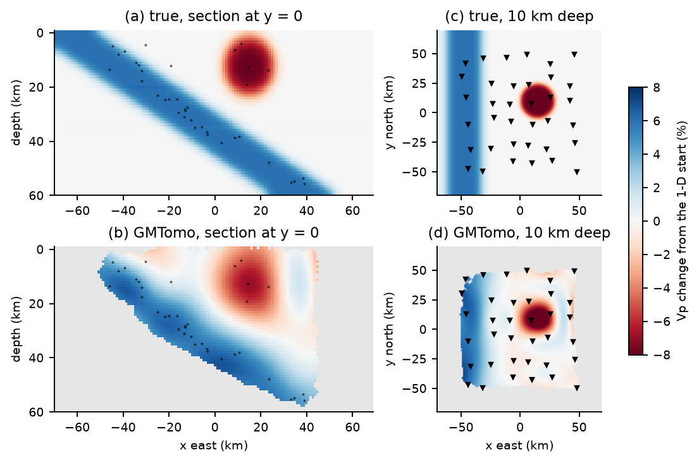

# GMTomo: Gaussian Macromodel Tomography

GMTomo turns earthquake arrival times into a 3-D P and S velocity model in minutes, with nothing to
tune: the model is a sum of Gaussians, and the damping is calibrated on fake earths with known answers.
How it works and why: [docs/DESIGN.md](docs/DESIGN.md).



## Use

```bash
git clone https://github.com/arthifact/GMTomo.git
cd GMTomo
uv sync
```

Put `stations.csv`, `events.csv` and `picks.csv` in a folder ([format](data/README.md)) and set `folder`
in [config.toml](config.toml). Then:

```bash
uv run src/invert.py      # -> outputs/<name>/: the model, its Gaussians, the residuals
uv run src/plot.py        # -> outputs/<name>/figures/
```

To try it first on a synthetic subduction zone (about 3 minutes in all):

```bash
uv run src/example.py     # -> data/example/
uv run src/invert.py
uv run src/plot.py
```

Every setting is in [config.toml](config.toml): the grid, the 1-D start and the sizes of the Gaussians.
Each run keeps its own folder ([outputs/README.md](outputs/README.md)).

Needs [uv](https://docs.astral.sh/uv/). Tests: `uv run tests/test_gmtomo.py`.

## License

[MIT](LICENSE)
