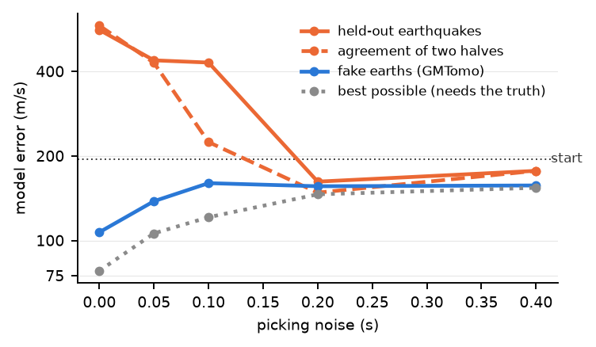

# How GMTomo was designed

GMTomo answers one question fast: what large-scale velocity structure do these arrival times demand? Every
choice below was settled by a measurement, in the order we made them. The first ones were made on 2-D tests
before GMTomo existed: waveforms through a 70 × 70 Marmousi model, and arrival times from a 2-D subduction
zone. They were then checked in 3-D on the example that `src/example.py` writes.

*The example: a slab 6% fast and a crustal body 8% slow, from 36 stations and 400 earthquakes whose catalogue
locations are off by 2 km horizontally and 4 km in depth. Dots: the true and the relocated earthquakes. Grey:
no ray passes. Two iterations, 98 s on a laptop.*

---

## 1. Arrival times, not waveforms

A macromodel says how long waves take to travel; it holds no sharp layers, so it cannot explain
reflections. Fitted to waveforms, smooth blobs explain them anyway, and wrongly.

- On Marmousi at 4-10 Hz, fitting only a window round the first arrival still made the model worse
  (562 to 626 m/s). With 690 m offsets, reflections arrive inside any such window.
- Blobs narrower than half a wavelength act as reflectors themselves.

An arrival time contains no reflection, so nothing can be fitted to one. It is also what every catalogue
already holds.

## 2. A sum of Gaussians

The model is a 1-D start plus Gaussians of a few widths (10, 20 and 40 km by default) on lattices spaced
1.5 widths apart: 626 of them over the example's 140 × 140 × 60 km.

- **Smooth by construction**: nothing narrower than the smallest width can appear.
- **Few numbers**: 626 instead of 1.2 million nodes, so the least-squares problem is solved exactly.
- **Separable**: a Gaussian is a product of three 1-D curves, so its effect on every ray is cheap.

## 3. One damped solve, not one Gaussian at a time

We first grew the model one Gaussian at a time, keeping each only if it also improved earthquakes it
was not fitted to. On clean 2-D data the fit improved sixty-fold while the model went from 195 to
819 m/s wrong. Rays constrain only sums along their paths: a strong blob here, cancelled by a strong blob
there, fits as well as the truth. A test on held-out data cannot see that.

One damped least-squares solve over every Gaussian at once shares the change among them and keeps
whatever the data cannot see at the start.

## 4. The damping, calibrated on fake earths

The damping decides how far the model may move. Choosing it from the data failed when the noise is low,
because data reward fitting anything shared by all earthquakes, including the trade-offs above:

*2-D subduction zone, one seed. Model error of the start: 195 m/s.*

GMTomo calibrates the damping on fake earths instead. The sensitivities depend only on the geometry and
the current model, so a fake earth's data cost one matrix product:

1. Estimate the noise from the residual of the current fit.
2. Make 100 fake earths of a few random Gaussians, as strong as the data suggest, with that noise.
3. Keep the damping that recovers them best. Repeat four times.

It is the only rule we tried that never made the model worse than the start, at any noise level. It
over-damps somewhat at moderate noise (138-160 m/s where 106-121 were possible). The noise estimates were
within 10% of the truth in 2-D, and within 10% in the 3-D example (0.055 s for 0.05 s, 0.110 s for 0.10 s).

## 5. Travel times from the eikonal equation

- **One field per station.** By reciprocity, the travel-time field from a station gives its time from every
  earthquake at once [1], so the cost grows with the number of stations, not of earthquakes.
- **Rays by steepest descent** through that field. Along a ray dt/dv = -∫ dl / v², which gives every pick's
  sensitivity to every Gaussian.
- **Fast marching** [2] errs by up to 1% along the directions the grid favours. In a uniform model the true
  times are known exactly, so that error is measured once per station and divided out: on a 1 km grid the
  mean error falls from 15 to 6 ms (exact answers for a velocity gradient, in `tests/test_gmtomo.py`).
  The idea is that of the factored eikonal equation [3].
- **1 km grid by default.** At 2 km the remaining error (13 ms on average, up to 90 ms) is close to typical
  picking noise.

## 6. Origin times and locations

An earthquake's origin time and location are as unknown as the velocities, and they trade off against them:
a quake placed too deep looks like slow rock above it. GMTomo handles both the standard way [4, 5]:

- **Relocate every earthquake** each iteration, in the current model, from its P and S picks (each phase
  weighted by its noise): four unknowns, at most 5 km per step. The time field's slope at the earthquake is
  how its times change when it moves, so this costs nothing new.
- **Separate the parameters.** Before the velocity solve, whatever an origin time or a small move of each
  earthquake could explain is projected out of its picks, in the data and the sensitivities alike. The
  velocities then cannot absorb location errors. Only differences between one earthquake's picks are used,
  so any clock will do.

On the example, with the catalogue off by 2.0 km horizontally and 3.9 km in depth:

| | Vp error where rays pass | Shape match | Locations (horizontal, depth) | Final P, S residual |
|---|---|---|---|---|
| Catalogue kept | 254 to 177 m/s | 0.73 | 2.0 km, 3.9 km | 0.251 s, 0.438 s |
| **Relocated** | 269 to **79 m/s** | **0.93** | **0.4 km, 0.9 km** | **0.056 s, 0.111 s** |
| *True locations given* | *273 to 54 m/s* | *0.97* | | |

Kept, the wrong locations spoil the model and leave residuals five times the noise. Relocated, residuals
fall to the noise and the model gets most of the way back.

## 7. What it recovers

On the example after two iterations, relocating (98 s):

| | Vp error | Shape match | Vs error | Shape match |
|---|---|---|---|---|
| Where rays pass | 269 to **79 m/s** | 0.93 | 151 to **52 m/s** | 0.91 |
| Under the network, 0-50 km | 220 to 136 m/s | | 131 to 91 m/s | |

*Shape match: the correlation between the true and the recovered change from the start.* Where no ray
passes the model stays at the start. Peaks overshoot a little, and a small fast patch appears beside the
slow body: a trade-off the data cannot resolve.

## 8. What it does not do yet

- **Large regions.** The Earth is flat, which suits a few hundred kilometres.
- **Station corrections, anisotropy, later phases.** First P and S arrivals only.
- **Real data.** So far only synthetic tests, one seed each.

## References

1. Rawlinson & Sambridge. Wave front evolution in strongly heterogeneous layered media using the fast marching method. *GJI* 156, 2004.
2. Sethian. A fast marching level set method for monotonically advancing fronts. *PNAS* 93(4), 1996.
3. Fomel, Luo & Zhao. Fast sweeping method for the factored eikonal equation. *J. Comput. Phys.* 228, 2009.
4. Thurber. Earthquake locations and three-dimensional crustal structure in the Coyote Lake area, central California. *JGR* 88(B10), 1983.
5. Pavlis & Booker. The mixed discrete-continuous inverse problem: application to the simultaneous determination of earthquake hypocenters and velocity structure. *JGR* 85(B9), 1980.
